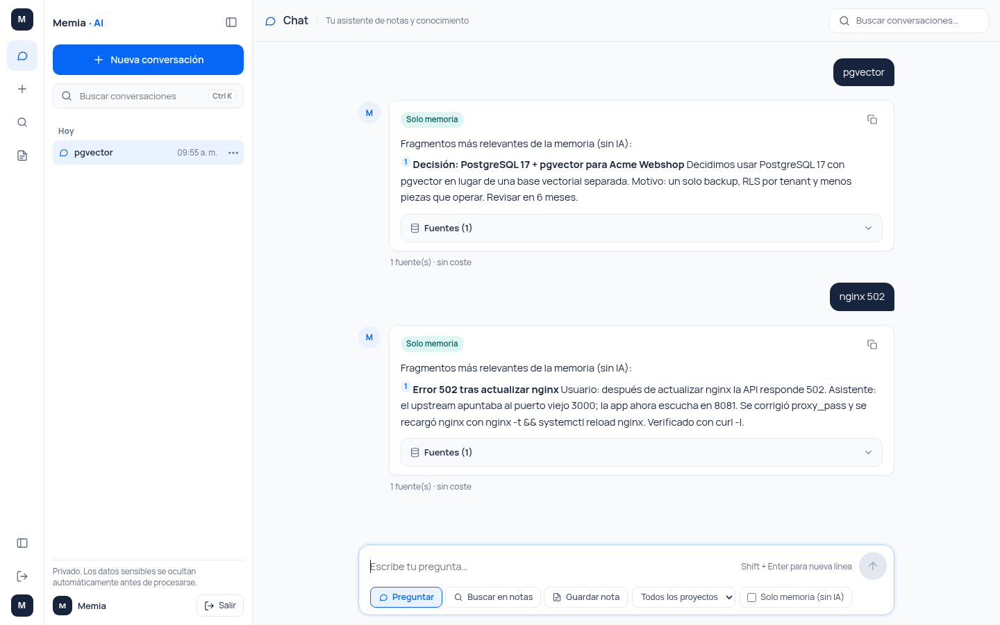
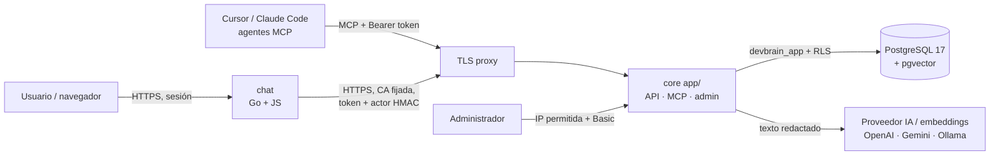
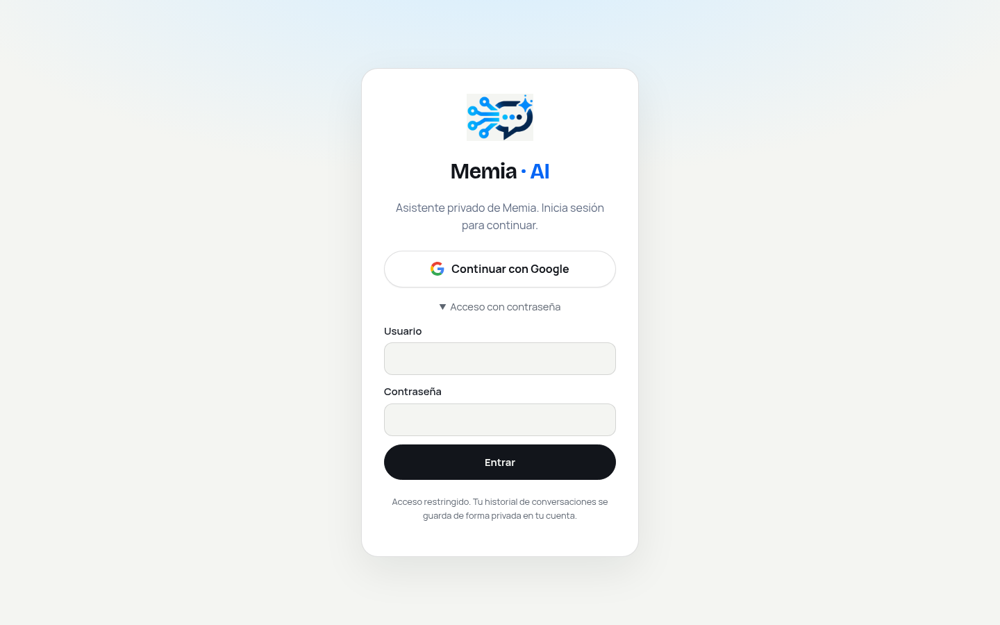
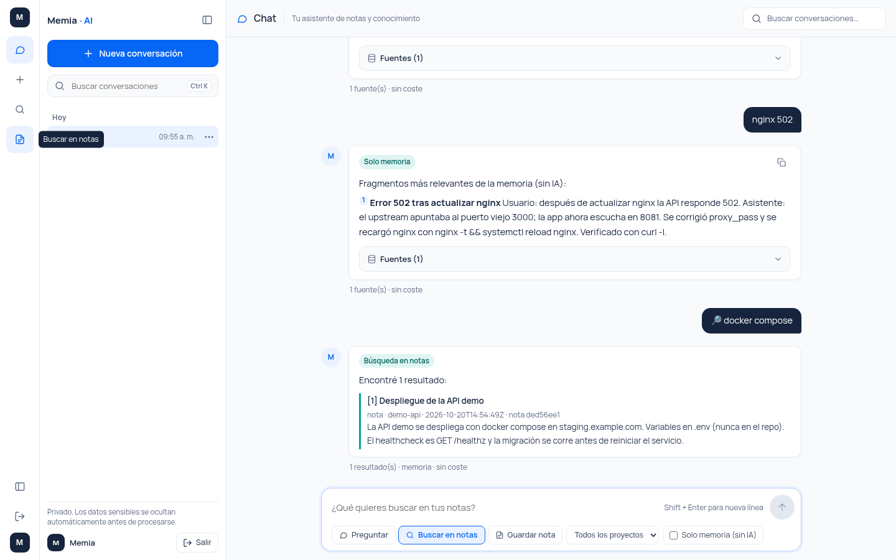

<p align="center"></p>

<h1 align="center">Memia</h1>
<p align="center"><b>Memoria privada para IA · Private memory layer for AI</b></p>

<p align="center">
<a href="LICENSE"></a>


</p>

**ES —** Memia guarda tu contexto (proyectos, decisiones, notas, conversaciones, recetas) en PostgreSQL + pgvector con aislamiento por tenant (RLS) y se lo entrega a tus herramientas de IA —chat web y agentes de programación vía MCP— para que no tengas que repetirlo y gastes menos tokens. Los datos sensibles se redactan antes de salir hacia cualquier proveedor de IA.

**EN —** Memia stores your context (projects, decisions, notes, conversations, recipes) in PostgreSQL + pgvector with per-tenant row-level security and serves it to your AI tools — web chat and coding agents over MCP — so you stop repeating yourself and spend fewer tokens. Sensitive data is redacted before it reaches any AI provider.



## Funcionalidades / Features

- 🧠 **Memoria persistente** — notas, conversaciones y documentos por proyecto, con búsqueda full-text y semántica (pgvector).
- 💸 **Respuestas sin IA** — responde desde la memoria con coste 0 cuando basta; la IA solo se usa si aporta.
- 🔌 **Servidor MCP** — `search_history`, `find_solution`, `get_project_rules`, `get_pending`, `save_verified_recipe` para Cursor, Claude Code y otros agentes.
- ✅ **Recetas verificadas** — soluciones reutilizables que solo se marcan `verified` con evidencia y aprobación.
- 🔒 **Privacidad** — RLS por tenant, tokens con hash y scopes, redacción de secretos y datos personales antes de cualquier proveedor.
- 📊 **Panel de uso** — coste por día/operación/tenant, caché de embeddings, redacciones y errores.
- 🧩 **Módulos por usuario** — el administrador decide quién tiene chat, notas o cotizador; todo queda auditado.
- 🤖 **Proveedores intercambiables** — OpenAI, Gemini u Ollama local; o ninguno (modo solo-memoria).

## Arquitectura / Architecture



## Inicio rápido / Quickstart

```bash
git clone https://github.com/joseareche/memia.git && cd memia
cp .env.docker.example .env.docker            # cambia todos los valores / change every value
sed -i "s/^DEVBRAIN_ACTOR_HMAC_KEY=.*/DEVBRAIN_ACTOR_HMAC_KEY=$(openssl rand -hex 32)/" .env.docker
docker compose --env-file .env.docker up -d --build
export MEMIA_TOKEN=<MEMIA_DEV_TOKEN>           # de / from .env.docker
./examples/seed-demo.sh                        # datos ficticios / fake demo data
```

- Chat: http://localhost:8093/chat (usuario `default`, contraseña `CHAT_DEV_PASSWORD`)
- Admin: http://localhost:8080/admin (contraseña `MEMIA_ADMIN_PASSWORD`)
- MCP: http://localhost:8080/mcp

Conectar Cursor (`~/.cursor/mcp.json`):

```json
{ "mcpServers": { "memia": { "url": "http://localhost:8080/mcp",
  "headers": { "Authorization": "Bearer ${env:MEMIA_TOKEN}" } } } }
```

## Capturas / Screenshots

| | |
|---|---|
|  |  |
|  |  |
|  | |

## Documentación / Documentation

- 📘 [Manual de instalación (ES)](docs/es/manual-instalacion.md) — requisitos, Docker, instalación manual, migraciones, configuración, MCP, panel, módulos, seguridad, backups, solución de problemas.
- 📗 [Installation summary (EN)](docs/en/installation.md)
- 🧪 [Ejemplos / Examples](examples/) — `curl`, cliente MCP, datos de ejemplo.

## Estructura / Layout

```
app/        core (Go): API, MCP, embeddings, redacción, admin, migraciones
chat/       chat web (Go + JS vanilla), login con contraseña o Google OIDC
deploy/     Dockerfiles, init de base de datos y proxy TLS para desarrollo
docs/       manuales e imágenes
examples/   scripts y datos de ejemplo
mcp/        cliente MCP de prueba
```

## Desarrollo / Development

```bash
cd app  && go build ./... && go test ./...
cd chat && go build ./... && go test ./...
```

Nunca subas secretos: usa `.env.docker` / variables de entorno / credenciales de systemd (ignorados por git).

## Licencia / License

Apache License 2.0 — © Jose Areche. Ver [`LICENSE`](LICENSE) y [`NOTICE`](NOTICE).
Contacto / contact: jose.areche@gmail.com
