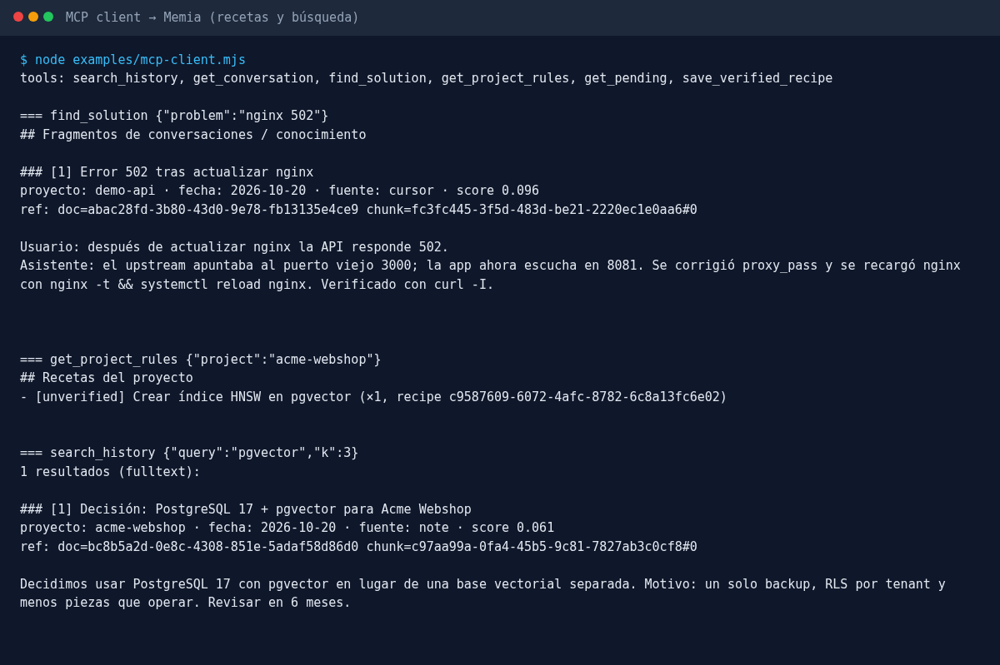
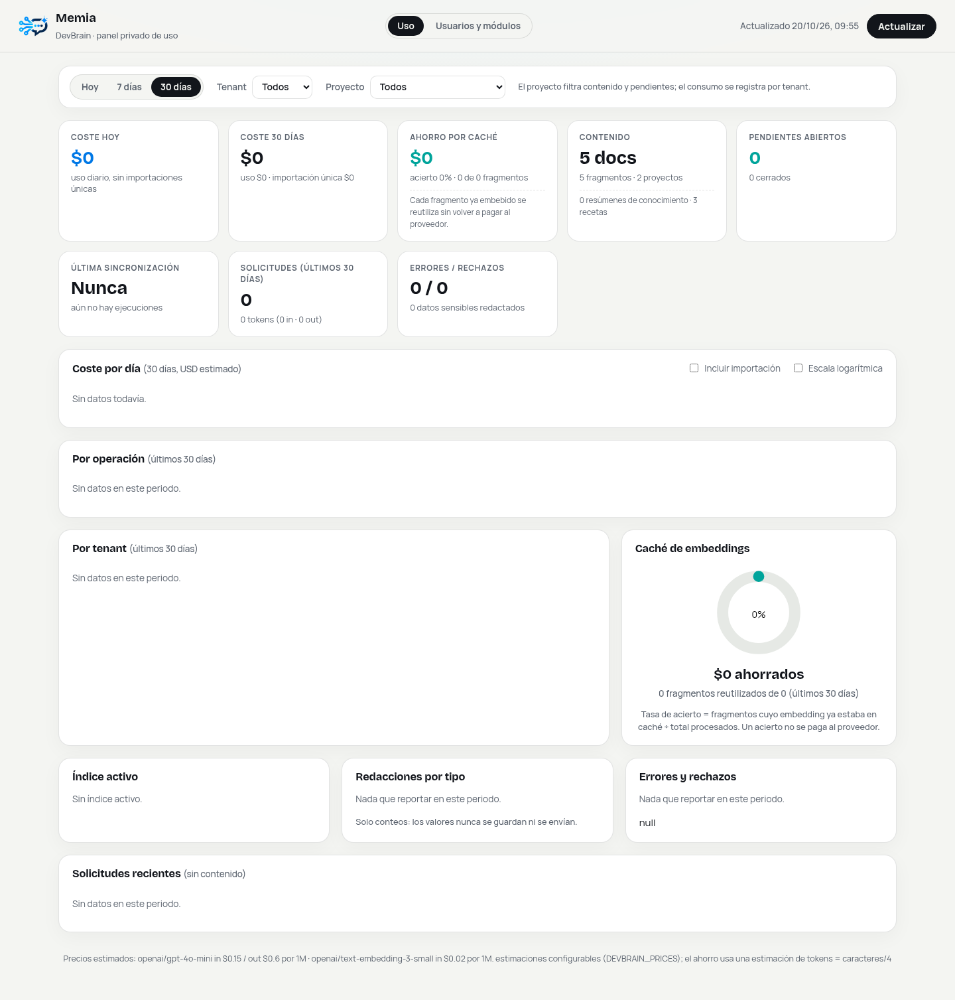
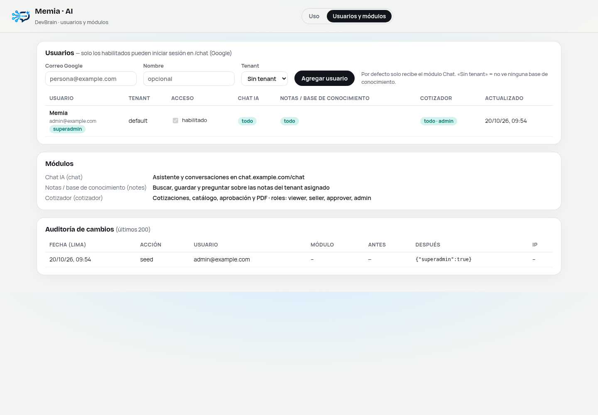

# Manual de instalación de Memia

> Idioma principal: español. Resumen en inglés: [../en/installation.md](../en/installation.md).

Memia tiene dos servicios en Go y una base de datos:

| Componente | Carpeta | Qué hace |
|---|---|---|
| **Core** | `app/` | API REST, servidor MCP, embeddings, redacción, panel de administración y CLI de mantenimiento. |
| **Chat** | `chat/` | Interfaz web autenticada (contraseña o Google OIDC). Hace de proxy hacia el core; el navegador nunca ve el token, la URL interna ni la base de datos. |
| **PostgreSQL 17 + pgvector** | `app/migrations/` | Memoria, recetas, pendientes, uso y módulos, aislados por tenant con Row-Level Security. |

## 1. Requisitos

- **Go 1.24+** (solo si compilas sin Docker).
- **PostgreSQL 17** con la extensión **pgvector** (sin pgvector Memia funciona en modo solo full-text).
- **Proveedor de embeddings / IA (opcional)**: una clave en variable de entorno — `OPENAI_API_KEY`, `GEMINI_API_KEY` — o un servidor **Ollama** local (`DEVBRAIN_OLLAMA_URL`). Sin proveedor, Memia responde desde la memoria (full-text) con coste 0.
- **LibreOffice (opcional)**: solo para exportar cotizaciones a PDF (módulo cotizador).
- Para el entorno local: **Docker** con el plugin **Compose v2**.

## 2. Inicio rápido con Docker Compose (desarrollo local)

El archivo [`docker-compose.yml`](../../docker-compose.yml) levanta todo: PostgreSQL+pgvector, core, un proxy TLS interno (Caddy) y el chat.

```bash
git clone https://github.com/joseareche/memia.git && cd memia
cp .env.docker.example .env.docker      # cambia TODOS los valores (openssl rand -hex 32)
sed -i "s/^DEVBRAIN_ACTOR_HMAC_KEY=.*/DEVBRAIN_ACTOR_HMAC_KEY=$(openssl rand -hex 32)/" .env.docker
docker compose --env-file .env.docker up -d --build
docker compose --env-file .env.docker ps
curl -s http://localhost:8080/readyz     # {"status":"ready"}
```

| URL | Acceso |
|---|---|
| http://localhost:8093/chat | usuario `default`, contraseña `CHAT_DEV_PASSWORD` |
| http://localhost:8080/admin | usuario cualquiera, contraseña `MEMIA_ADMIN_PASSWORD` (HTTP Basic) |
| http://localhost:8080/mcp | servidor MCP, `Authorization: Bearer $MEMIA_DEV_TOKEN` |

Al iniciar por primera vez, `deploy/docker/initdb/00-memia.sh`:
1. crea los roles `devbrain_owner` (dueño de las tablas, BYPASSRLS) y `devbrain_app` (el que usa la API, sujeto a RLS);
2. crea las extensiones `vector` y `pgcrypto`;
3. aplica todas las migraciones de `app/migrations/` en orden;
4. crea el tenant `default`, el usuario `admin@example.com` y un token API con el valor de `MEMIA_DEV_TOKEN` (guardado solo como SHA-256).

Cargar datos de ejemplo (ficticios):

```bash
export MEMIA_TOKEN=<valor de MEMIA_DEV_TOKEN>
./examples/seed-demo.sh
```

Notas del stack:
- PostgreSQL **no** publica puertos; core y chat solo escuchan en `127.0.0.1` del host.
- El chat habla con el core por **HTTPS con CA fijada** (como en producción): Caddy emite un certificado interno para `memia-core` y publica solo el certificado raíz público para que el chat lo fije.
- Reiniciar desde cero: `docker compose --env-file .env.docker down -v`.

## 3. Instalación manual (servidor)

### 3.1 Base de datos

```bash
sudo apt install postgresql-17 postgresql-17-pgvector
sudo -u postgres psql <<'SQL'
CREATE DATABASE devbrain;
CREATE ROLE devbrain_owner NOLOGIN BYPASSRLS;
CREATE ROLE devbrain_app LOGIN;            -- autenticación peer por socket unix
ALTER DATABASE devbrain OWNER TO devbrain_owner;
\c devbrain
GRANT ALL ON SCHEMA public TO devbrain_owner;
CREATE EXTENSION IF NOT EXISTS vector;
CREATE EXTENSION IF NOT EXISTS pgcrypto;
SQL
```

### 3.2 Migraciones

Son idempotentes y se ejecutan **como `devbrain_owner`**, en orden numérico:

```bash
for f in app/migrations/0*.sql; do
  sudo -u postgres psql -v ON_ERROR_STOP=1 -d devbrain -c "SET ROLE devbrain_owner" -f "$f"
done
```

- `001`–`004`: esquema, RLS, vectores y embeddings. `005`/`009`: uso y estadísticas. `007`: recetas. `008`: pendientes. `010`: notas. `011`–`012`: cotizador. `013`: módulos por usuario.
- Las migraciones `011`–`013` siembran datos para un tenant llamado `default`: créalo antes (ver 3.4) o vuelve a correrlas después.
- Reversión: `app/migrations/down/` (solo para `011`–`013`).
- Pruebas de aislamiento: `app/test/tenant_isolation.sql` y `app/test/embeddings_isolation.sql`.

### 3.3 Compilar

```bash
cd app  && go build -mod=vendor -o /usr/local/bin/memia ./cmd/devbrain && go test ./...
cd chat && go build -o /usr/local/bin/memia-chat . && go test ./...
```

### 3.4 Tenant, usuario y token

```bash
TOKEN=$(openssl rand -hex 32)
sudo -u postgres psql -d devbrain -v tok="$TOKEN" <<'SQL'
SET ROLE devbrain_owner;
INSERT INTO tenants (name) VALUES ('default') ON CONFLICT DO NOTHING;
INSERT INTO users (tenant_id, email, role) SELECT id, 'admin@example.com', 'owner' FROM tenants WHERE name='default';
INSERT INTO api_tokens (tenant_id, user_id, name, token_hash, scopes)
  SELECT t.id, u.id, 'cursor-laptop', digest(:'tok','sha256'), ARRAY['read','write','mcp','mcp:read']
  FROM tenants t JOIN users u ON u.tenant_id=t.id WHERE t.name='default';
SQL
echo "$TOKEN"   # guárdalo en tu gestor de secretos; no queda en ningún otro lugar
```

Scopes disponibles: `read`, `write`, `admin` (estadísticas), `distill`, `commercial` (cotizador), `mcp` / `mcp:read` (herramientas de lectura MCP), `mcp:write` (guardar recetas). Crea **un token por cliente/proyecto** con los scopes mínimos. Revocar: `UPDATE api_tokens SET revoked_at = now() WHERE name = '...'`.

### 3.5 Servicio

Ejecuta el core detrás de un proxy TLS (Caddy o nginx) y en una red privada. Usa `systemd` con `EnvironmentFile` legible solo por root o, mejor, credenciales de systemd (`LoadCredential=` → `$CREDENTIALS_DIRECTORY`). El chat lee `admin_password_hash`, `devbrain_token` y `actor_hmac_key` desde `$CREDENTIALS_DIRECTORY`.

## 4. Referencia de configuración

Ver [`.env.example`](../../.env.example).

### Core (`app/`)

| Variable | Por defecto | Descripción |
|---|---|---|
| `DEVBRAIN_LISTEN` | `127.0.0.1:8080` | Dirección HTTP (pon un proxy TLS delante). |
| `DEVBRAIN_DSN` | socket unix, `devbrain_app` | Conexión de la API (sujeta a RLS). |
| `DEVBRAIN_ADMIN_DSN` | socket unix, `postgres` | Conexión del CLI `memia admin` (actúa como `devbrain_owner`). |
| `DEVBRAIN_ALLOWED_ORIGINS` | vacío | Orígenes permitidos para el endpoint MCP (CSV). |
| `DEVBRAIN_ADMIN_ALLOW` | — | CIDRs que pueden abrir `/admin` (CSV). Sin esto el panel está deshabilitado. |
| `DEVBRAIN_ADMIN_PASSWORD_HASH` | — | Hash PBKDF2 de la contraseña del panel: `printf '%s' 'contraseña' \| memia hash-password`. |
| `DEVBRAIN_ACTOR_HMAC_KEY` | — | Hex ≥ 32 bytes. Firma el usuario que actúa (chat → core). Activa el cotizador y los módulos por usuario. |
| `DEVBRAIN_CHAT_PROVIDER` / `DEVBRAIN_CHAT_MODEL` | `openai` / `gpt-4o-mini` | Modelo para respuestas generadas. Sin clave, Memia responde solo desde la memoria. |
| `OPENAI_API_KEY`, `GEMINI_API_KEY` | — | Proveedores de embeddings/IA. Nunca se registran en logs. |
| `DEVBRAIN_OLLAMA_URL` | — | Embeddings locales con Ollama. |
| `DEVBRAIN_PRICES` | precios internos | `proveedor/modelo=in[:out],...` en USD por 1M tokens (para el panel de costes). |
| `DEVBRAIN_SOFFICE` | `/usr/bin/soffice` | LibreOffice para PDF; `off` lo desactiva. |

### Chat (`chat/`)

| Variable | Descripción |
|---|---|
| `CHAT_LISTEN` | Dirección HTTP (por defecto `127.0.0.1:8093`). |
| `CHAT_ORIGIN` | Origen público exacto (protección CSRF). |
| `CHAT_USER` / `CHAT_ACTOR_EMAIL` | Usuario del acceso con contraseña y correo con el que actúa. |
| `CHAT_ALLOWED_EMAILS` | Correos de emergencia para Google login (el resto se gestiona en el panel). |
| `CHAT_COMMERCIAL_QUOTES_AI` | `1` muestra el asistente de cotizaciones en el chat. |
| `DEVBRAIN_URL`, `DEVBRAIN_SERVER_NAME`, `DEVBRAIN_CA_FILE` | URL HTTPS del core, nombre del certificado y CA fijada. |
| `GOOGLE_CLIENT_ID`, `GOOGLE_CLIENT_SECRET`, `GOOGLE_REDIRECT_URL` | Google OIDC (opcional). |
| `STATE_DIRECTORY` | Carpeta donde se guarda el historial de conversaciones. |

## 5. Embeddings (búsqueda semántica)

Sin índice activo la búsqueda es full-text (PostgreSQL `tsvector`). Para activar la semántica:

```bash
memia admin index create -name oai-small -provider openai -model text-embedding-3-small -dims 1536
memia admin index build oai-small
memia admin index activate oai-small
memia admin index list
```

Política por tenant: `memia admin tenant policy default local_only` impide enviar contenido a proveedores externos (solo Ollama).

## 6. MCP para agentes de programación

Herramientas expuestas: `search_history`, `get_conversation`, `find_solution`, `get_project_rules`, `get_pending` (lectura) y `save_verified_recipe` (escritura; queda `unverified` salvo que incluya `evidence` **y** `approved_by`).

**Cursor** — `~/.cursor/mcp.json` (o `.cursor/mcp.json` del proyecto):

```json
{
  "mcpServers": {
    "memia": {
      "url": "https://memia.internal.example/mcp",
      "headers": { "Authorization": "Bearer ${env:MEMIA_TOKEN}" }
    }
  }
}
```

**Claude Code**:

```bash
claude mcp add --transport http memia https://memia.internal.example/mcp \
  --header "Authorization: Bearer $MEMIA_TOKEN"
```

Si usas una CA privada, instálala en el sistema o exporta `NODE_EXTRA_CA_CERTS=/ruta/root-ca.crt`. En local usa `http://localhost:8080/mcp`. Prueba rápida: [`examples/mcp-client.mjs`](../../examples/mcp-client.mjs).



## 7. Panel de administración

`/admin` (HTTP Basic + lista de IPs permitidas). Muestra coste por día, por operación y por tenant, caché de embeddings, índice activo, redacciones por tipo, errores y solicitudes recientes (sin contenido). `/admin/users` gestiona usuarios, tenant asignado y módulos.



## 8. Módulos

Cada usuario recibe solo los módulos que el administrador habilita (`platform_modules`, `user_modules`), y cada cambio queda en `entitlement_audit`:

| Módulo | Qué habilita |
|---|---|
| `chat` | Chat y conversaciones. |
| `notes` | Buscar, guardar y preguntar sobre las notas del tenant. |
| `cotizador` | Cotizaciones, catálogo, aprobación y PDF (roles `viewer`, `seller`, `approver`, `admin`). |



## 9. Seguridad

- **RLS por tenant** (`FORCE ROW LEVEL SECURITY`): cada consulta fija `app.tenant_id` en la transacción; la API usa `devbrain_app`, que no puede saltarse las políticas.
- **Tokens** guardados solo como SHA-256, con scopes, caducidad y revocación.
- **Redacción** antes de enviar a un proveedor externo: claves privadas, JWT, claves de API, tokens, credenciales en URLs/SIP, asignaciones `password=`, correos y teléfonos. `redact_storage=true` guarda solo el texto redactado. El panel solo guarda conteos, nunca valores.
- **El chat** es el único expuesto: sesiones `__Host-` `Secure` `SameSite=Strict`, límite de intentos, CSP estricta, y TLS con CA fijada hacia el core.
- No expongas PostgreSQL ni el core a Internet. No guardes secretos en el repositorio ni en logs.

## 10. Backups

```bash
sudo -u postgres pg_dump -Fc devbrain | gzip > memia-$(date +%F).dump.gz      # diario
gpg --symmetric --cipher-algo AES256 memia-$(date +%F).dump.gz                 # cifra antes de sacarlo del servidor
sudo -u postgres pg_restore -d devbrain_restore memia-AAAA-MM-DD.dump          # prueba la restauración
```

Guarda una copia fuera del servidor y prueba restaurarla periódicamente. Con Docker: `docker compose exec db pg_dump -U postgres -Fc memia > memia.dump`.

## 11. Solución de problemas

| Síntoma | Causa / solución |
|---|---|
| `/readyz` → `db unavailable` | DSN incorrecto o base aún inicializándose. `docker compose logs db`. |
| `401` en la API o MCP | Token inválido, revocado o caducado; revisa `Authorization: Bearer`. |
| `403 admin scope required` | El token no tiene el scope `admin`. |
| `/admin` responde 403 | Tu IP no está en `DEVBRAIN_ADMIN_ALLOW`, o falta `DEVBRAIN_ADMIN_PASSWORD_HASH`. |
| El chat dice «módulo no habilitado» | Habilítalo en `/admin/users`; comprueba que el chat alcanza el core (`DEVBRAIN_URL`, CA y `DEVBRAIN_SERVER_NAME`). |
| `cannot load DevBrain CA` | `DEVBRAIN_CA_FILE` no existe o no es PEM. |
| Búsqueda sin resultados | El full-text exige todos los términos; usa palabras clave o activa un índice de embeddings. |
| `semantic: skipped (no active index)` | Normal sin proveedor; ver sección 5. |
| MCP en Cursor no conecta | URL accesible desde tu máquina, CA instalada, token con scope `mcp`. |
| Login bloqueado 15 minutos | Demasiados intentos fallidos; espera o reinicia el servicio de chat. |
